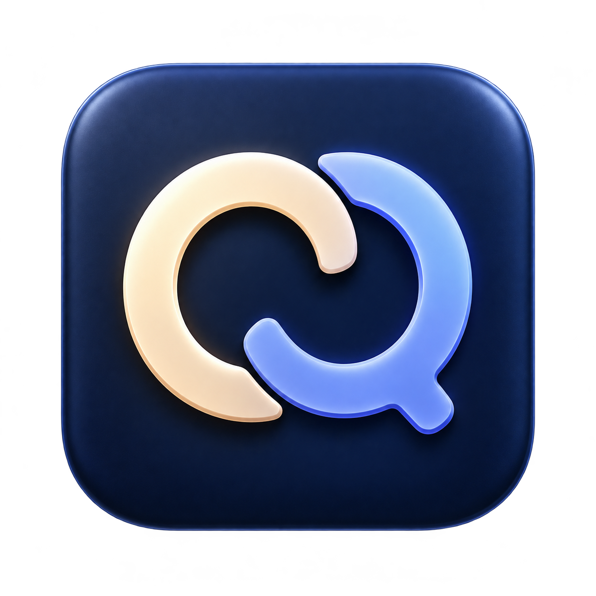

# QuotaBar

[English](README.md) · **简体中文**



抬头看一眼，就知道 Claude Code 和 Codex 还剩多少额度。

一个轻量的原生 macOS 菜单栏工具：左边 Claude，右边 Codex，只显示服务图标和剩余百分比，不用一直开着用量页面。

**[下载 Mac 安装包 DMG（Apple Silicon）](https://github.com/AI-GENE/QuotaBar/releases/download/v1.0.0-preview.1/QuotaBar.dmg)** · [下载 ZIP](https://github.com/AI-GENE/QuotaBar/releases/download/v1.0.0-preview.1/QuotaBar.zip) · [版本说明](https://github.com/AI-GENE/QuotaBar/releases/tag/v1.0.0-preview.1)

> 当前为本地临时签名、未经 Apple 公证的开发预览版。macOS 通常会阻止从网络下载的此类应用；不要为此关闭 Gatekeeper。若你的安全政策要求 Developer ID 签名或 Apple 公证，请等待后续版本或按需审查源码。Claude 查询仍可能失败，安装前请阅读下面的要求与限制。

## 能看到什么

- 菜单栏显示两家服务的**本周剩余额度**，不是美元余额，也不是 API 预付费余额。
- 点击可查看五小时用量窗口、本周额度、重置时间和查询状态，也可以手动刷新。
- 电脑唤醒时刷新；保持唤醒期间约每五分钟自动刷新一次。
- 缺少数据时显示 `—`，旧数据用 `†` 标记；已经过期的用量窗口不会继续显示为当前额度。
- 可选“登录时启动”，默认关闭。原生应用，不依赖 Electron，也不需要额外的运行时安装包。

应用界面目前为中文，菜单栏服务图标会适应系统外观。QuotaBar 常驻菜单栏，**不在 Dock 中显示，也不会自动创建桌面快捷方式**。菜单栏拥挤或受到屏幕刘海遮挡时，可能需要先隐藏其他菜单栏项目。

## 安装要求

- 下载版仅适用于 **Apple Silicon（M 系列）Mac**。
- 构建目标为 macOS 14 及以上；目前在 macOS 26.5 测试，并未验证所有兼容版本。
- 已安装并登录官方 Codex 客户端，以及使用 Claude 订阅登录的官方 Claude Code CLI。
- 下载版不需要自己编译；从源码构建则需要 Swift 6.2 及以上和 Xcode 命令行工具。

## 安装与首次使用

1. 下载并打开 `QuotaBar.dmg`，将 QuotaBar 拖入 Applications。若旧版正在运行，请先从菜单栏退出，避免出现两个图标。
2. 登录官方 Codex 客户端。目前支持 `$CODEX_HOME/auth.json` 或 `~/.codex/auth.json` 中的文件式 OAuth 凭据；仅存于钥匙串的凭据，以及仅使用 API Key 的账号，暂不支持。
3. 安装官方 Claude Code CLI，并使用 Claude 订阅完成登录。QuotaBar 会在 `~/.local/bin`、`/opt/homebrew/bin` 或 `/usr/local/bin` 查找 `claude`。
4. 由你本人为独立的用量查询目录完成一次初始化：

   ```sh
   mkdir -p "$HOME/Library/Application Support/QuotaBar/Probe"
   cd "$HOME/Library/Application Support/QuotaBar/Probe"
   claude --safe-mode --no-chrome --strict-mcp-config --mcp-config '{"mcpServers":{}}' --tools '' --settings '{"remoteControlAtStartup":false}' --ax-screen-reader /usage
   ```

   如果 Claude 询问是否信任工作目录，请先确认它指向的**只有这个 Probe 目录**，再自行决定。由你本人完成官方登录和初始化提示，之后按 Ctrl-C 退出。QuotaBar 不会代你接受目录信任、安全授权或登录提示。
5. 打开 Applications 中的 QuotaBar，在顶部菜单栏查看额度。

临时签名不能证明发布者身份。下载页提供的 SHA-256 校验文件仅用于核对文件完整性，**不等于 Apple 公证或身份认证**。

## 隐私与安全

QuotaBar 没有开发者运营的服务器、分析或遥测服务。查询额度时仍需向相应服务商发送经过认证的请求：

- **Codex：**把现有 OAuth 访问令牌和账号标识读入内存，仅发送到 `chatgpt.com` 上固定的 HTTPS 用量接口。禁止重定向、持久 Cookie 和 HTTP 缓存；不刷新或改写登录凭据。
- **Claude：**在独立 Probe 目录中调用本地官方 CLI 的 `/usage` 内置命令，并关闭工具、Chrome 集成、自定义配置、MCP 服务和启动远程控制。QuotaBar 不读取 Claude 钥匙串条目，也不接收其令牌；由官方 CLI 自行认证和访问服务，其常规目录中仍可能写入自身会话元数据。
- 查询进程默认分别关闭遥测、错误上报、自动更新和反馈，而不是强制设置一揽子的网络限制；保留用户明确传入的隐私设置。这修正了在 Claude Code 2.1.303 上复现的用量加载兼容问题，但不能保证服务始终可用。
- 捕获的用量查询输出只在内存中暂存，有大小上限，不由 QuotaBar 写入磁盘。`--check` 诊断输出不包含令牌或账号标识，但含真实用量和重置时间；分享前仍应脱敏。
- 登录、令牌更新、钥匙串提示与安全决策由官方客户端及用户本人处理。**不要向 Issue、聊天或日志中粘贴令牌。**

这些集成依赖服务商的具体实现，并非有保证的公共用量 API。CLI 输出、接口和访问政策变化时，可能暂时无法查询。QuotaBar 与 Anthropic、OpenAI 没有隶属或背书关系。

## 常见问题

**为什么桌面或 Dock 上找不到？**

这是菜单栏应用。安装后从 Applications 打开；运行后看屏幕顶部。需要独立窗口时，可点击菜单中的“额度详情…”。

**为什么显示 `—`、`†` 或查询失败？**

`—` 表示没有可用数据，`†` 表示旧数据，不代表额度为零。先确认官方客户端登录及首次初始化已完成。Claude `/usage` 可能加载失败；Codex 也可能只返回本周额度而不提供五小时数据。当前通用超时提示不能精确指出底层 HTTP 原因。

**安装包为什么叫 `QuotaBar.dmg`，没有长版本号？**

为了方便查找，文件名保持简短；版本号和适用芯片在下载页说明。安装包打开后的磁盘和 App 使用 QuotaBar 图标；DMG 文件本身也设置了本机自定义图标，但普通网页下载不一定保留这种文件元数据。

## 从源码构建

```sh
git clone https://github.com/AI-GENE/QuotaBar.git
cd QuotaBar
./build.sh
```

脚本运行离线测试、编译应用、打包矢量资源并添加本地临时签名，产物为 `dist/QuotaBar.app`。如需生成 DMG、ZIP 和 SHA-256 校验文件，运行 `./package.sh`；该步骤使用 macOS 的磁盘映像与文件元数据工具。不会附带签名凭据。

自定义 `CODEX_HOME` 从应用的启动环境读取；从 Finder 启动不会自动读取终端的 Shell 配置。重新编译临时签名版本后，可能需要重新启用“登录时启动”。

## 开发与测试

```sh
swift test
swift run QuotaBar
```

测试使用模拟数据，不需要账号凭据，也不请求服务商。运行应用或 `--check` **会查询你的真实账号**，不要在 CI 中使用真实凭据。

## 开源许可

应用代码和原创应用图标使用 MIT 许可证。应用图标由 AI 生成；服务商标志的权利仍归其所有者。Simple Icons、LobeHub 素材来源与许可详见 [品牌说明](Sources/QuotaCore/Resources/BrandNotices.txt)。
